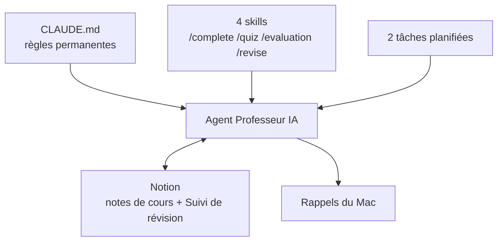

# Professeur IA

Un agent IA qui joue le rôle de professeur particulier pour mes cours de MSc IA générative et agentique (aivancity). Il lit mes notes de cours dans Notion, les complète, m'interroge, suit mes progrès et planifie mes révisions selon mon emploi du temps.

Je l'ai construit avec Claude Code, sans écrire de code : des instructions en français, un connecteur Notion, quatre commandes et deux tâches planifiées.

## Ce que fait l'agent

| Besoin | Ce que fait l'agent | Déclencheur |
|---|---|---|
| Compléter mes notes | Repère les erreurs, imprécisions et manques, puis propose des compléments | `/complete`, ou automatiquement les soirs de cours |
| Apprendre un cours | Test guidé, une question à la fois, correction immédiate | `/quiz [cours]` |
| Mesurer mon niveau | 10 questions à la suite, correction à la fin, note sur 20 | `/evaluation` |
| Mémoriser | Révision espacée (méthode des J), tous cours mélangés | `/revise` |
| Ne rien oublier | Calcule ma prochaine séance et crée un rappel sur mon Mac | Automatique |

## Architecture

## Le parcours en quatre temps

| Étape | Contenu | Fichier |
|---|---|---|
| 1. Le premier prompt | Un rôle, un niveau et trois modes | [`docs/1-prompt-v1.md`](docs/1-prompt-v1.md) |
| 2. La réflexion | Ce qui manquait à l'usage, et les décisions prises | [`docs/2-reflexion.md`](docs/2-reflexion.md) |
| 3. Le prompt final | Quatre modes, emploi du temps, planification, suivi | [`CLAUDE.md`](CLAUDE.md) |
| 4. Les commandes et l'automatisation | Quatre skills et deux tâches planifiées | [`.claude/skills/`](.claude/skills/) et [`docs/3-taches-planifiees.md`](docs/3-taches-planifiees.md) |

## Ce que j'ai retenu

- **Un agent fait ce qui est écrit, pas ce qu'on avait en tête.** Chaque imprécision est un endroit où il doit deviner.
- **Le moins de droits possible.** L'agent n'a accès qu'à un dossier et à un espace Notion.
- **Plus un agent travaille seul, moins il a le droit d'écrire.** Mes tâches planifiées lisent Notion mais n'y écrivent pas.
- **Une validation humaine avant toute écriture dans mes notes.**
- **Une seule source de vérité.** Les skills renvoient à `CLAUDE.md` au lieu d'en recopier les règles.

## Limites

- Les tâches planifiées ne tournent que si le Mac est allumé et l'application ouverte.
- Les dates de la méthode des J sont décalées au premier créneau libre, pas suivies au jour près.
- Les rappels ne fonctionnent que sur macOS.

## Prochaines améliorations

Des pistes que je n'active pas encore : chacune dépend de ce que l'usage réel montrera.

| Amélioration | Ce que j'attends avant de la lancer |
|---|---|
| **Compléments écrits sans mon accord.** L'agent écrirait directement dans Notion, sans passer par le brouillon. | Plusieurs propositions de suite validées sans aucune correction de ma part. |
| **Tâches dans le cloud.** Elles tourneraient même Mac éteint. | Trouver comment leur donner accès aux règles de `CLAUDE.md` sans mon dossier local. |
| **Créneaux et rythme ajustés.** Heures des rappels, durée des séances, nombre de soirs par semaine. | Quelques semaines de pratique, pour voir quelles séances je saute. |
| **Mélange des cours en révision.** Vérifier que `/revise` interroge bien sur plusieurs cours à la fois. | Avoir au moins deux cours dans « Suivi de révision ». |
| **Mode « préparation d'examen ».** Une révision intensive sur un cours, à l'approche d'une date. | Connaître mon calendrier d'examens. |
