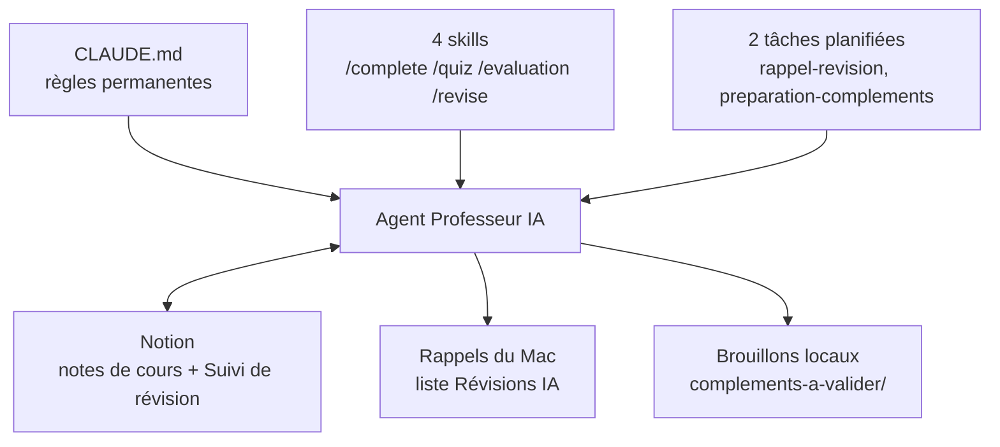

# Professeur IA

Un agent IA qui joue le rôle de professeur particulier pour mes cours de MSc IA générative et agentique (aivancity). Il lit mes notes de cours dans Notion, les complète, m'interroge, suit mes progrès et planifie mes révisions selon mon emploi du temps.

Je l'ai construit avec Claude Code, sans écrire de code : uniquement des instructions en français, un connecteur et des tâches planifiées. Ce dépôt documente la construction, les choix faits en route et tous les prompts utilisés.

## Ce que fait l'agent

| Besoin | Ce que fait l'agent | Comment je le déclenche |
|---|---|---|
| Compléter mes notes | Repère les erreurs, imprécisions et manques, puis propose des compléments | `/complete`, ou automatiquement les soirs de cours |
| Apprendre un cours | Test guidé, une question à la fois, correction immédiate | `/quiz [cours]` |
| Mesurer mon niveau | 10 questions à la suite, correction à la fin, note sur 20 | `/evaluation` |
| Mémoriser | Révision espacée (méthode des J), tous cours mélangés | `/revise` |
| Ne rien oublier | Calcule ma prochaine séance et crée un rappel sur mon Mac | Automatique |

## Comment il est construit



| Brique | Rôle | Fichier |
|---|---|---|
| Instructions | Les règles que l'agent relit au début de chaque session : rôle, niveau, modes, emploi du temps, suivi | [`CLAUDE.md`](CLAUDE.md) |
| Skills | Les commandes qui lancent chaque mode | [`.claude/skills/`](.claude/skills/) |
| Connecteur Notion | L'accès aux notes de cours et à la base « Suivi de révision » | Configuré dans l'application |
| Tâches planifiées | Ce que l'agent fait sans moi, à heure fixe | [`taches-planifiees/`](taches-planifiees/) |
| Rappels | La façon dont l'agent me relance | Application Rappels, via AppleScript |

## Une semaine type

**Un jour de cours (vendredi ou samedi, une semaine sur deux)**

1. 12 h : la tâche `rappel-revision` vérifie mon planning et crée le rappel du soir.
2. 17 h 30 : la tâche `preparation-complements` lit mes notes du jour et prépare ses compléments dans un fichier brouillon. Elle n'écrit rien dans Notion.
3. 17 h 45 : mon rappel sonne. Je lis les compléments, je valide, l'agent les écrit dans Notion.
4. J'enchaîne avec `/quiz` sur le cours du jour. L'agent met à jour mon suivi et crée le rappel de la séance suivante.

**Un autre soir**

Si des notions sont dues, un rappel sonne à 19 h. Je lance `/revise` pour 15 à 30 minutes. L'agent limite les révisions à 3 soirs par semaine.

## Les principes que j'ai retenus

- **Un agent fait ce qui est écrit, pas ce qu'on avait en tête.** Chaque imprécision dans une consigne est un endroit où il doit deviner.
- **Le moins de droits possible.** L'agent n'a accès qu'à un dossier et à un espace Notion. Une tâche qui tourne sans moi peut lire Notion mais pas y écrire.
- **Une validation humaine avant toute écriture dans mes notes.** Les compléments passent par un brouillon, jamais directement dans la page.
- **Une seule source de vérité.** Les skills renvoient aux règles de `CLAUDE.md` au lieu de les recopier.
- **Tester chaque brique avant d'ajouter la suivante.**

## Contenu du dépôt

```
.
├── README.md
├── CLAUDE.md                          Instructions permanentes de l'agent
├── .claude/skills/
│   ├── complete/SKILL.md              Compléter les notes d'un cours
│   ├── quiz/SKILL.md                  Test de cours
│   ├── evaluation/SKILL.md            Évaluation
│   └── revise/SKILL.md                Mémorisation
├── taches-planifiees/
│   ├── rappel-revision.md             Ronde quotidienne du planning
│   └── preparation-complements.md     Préparation des compléments
└── docs/
    ├── journal-de-construction.md     Étapes, modifications et améliorations
    └── prompts-de-construction.md     Les messages envoyés pour construire et tester
```

## Reproduire l'agent

Prérequis : l'application de bureau Claude avec un abonnement payant, un compte Notion, un Mac pour la partie Rappels.

1. Créer un dossier pour le projet et l'ouvrir dans l'onglet **Code** de l'application, en environnement **Local** et en mode de permission **Manual**.
2. Y copier `CLAUDE.md` et le dossier `.claude/`, puis adapter le rôle, le niveau, les sources et l'emploi du temps.
3. Brancher le connecteur Notion (bouton **+** > **Connectors**).
4. Créer dans Notion une base « Suivi de révision » avec, pour chaque notion : cours, définition, statut, dernière note, palier, dernière révision, prochaine révision.
5. Créer les deux tâches planifiées avec les instructions du dossier `taches-planifiees/`, lancer chacune une première fois avec **Run now** et accorder les permissions.

Le détail de chaque étape est dans le [journal de construction](docs/journal-de-construction.md).

## Limites connues

- Les tâches planifiées ne tournent que si le Mac est allumé et l'application ouverte. Une exécution manquée est rattrapée au réveil.
- La méthode des J n'est pas suivie au jour près : les dates sont des dates au plus tôt, décalées au premier créneau libre.
- L'emploi du temps est écrit en dur dans `CLAUDE.md`. Toute exception doit être signalée à l'agent.
- Les rappels ne fonctionnent que sur macOS.
